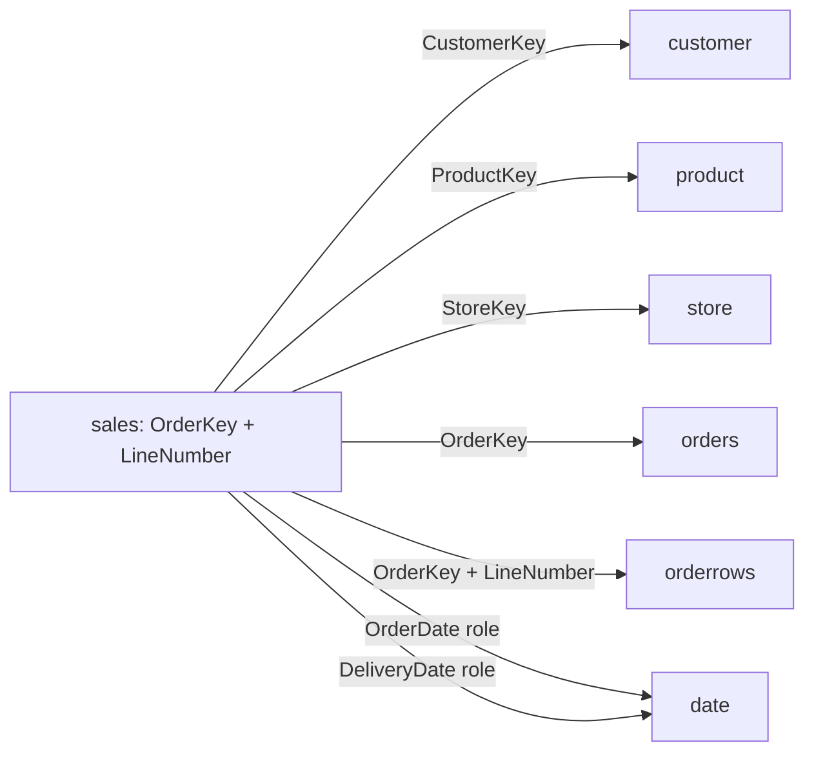
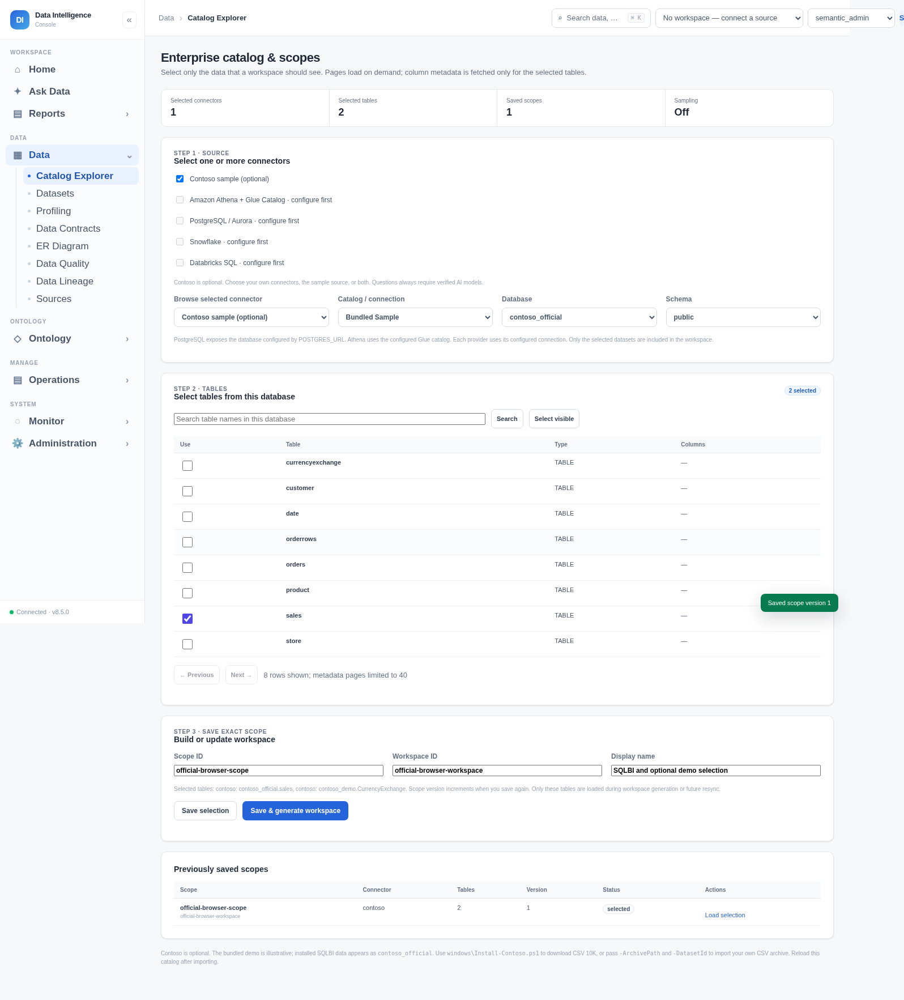

# Official SQLBI CSV 10K: review and integration

Reviewed on 2026-10-12. The user chose CSV 10K after uploading archives named `csv-1m.7z`. Both attachments exceeded the workspace's 32 MiB transfer limit, so their contents were not inspected. This review instead covers the actual CSV 10K asset downloaded from [SQLBI's public release](https://github.com/sql-bi/Contoso-Data-Generator-V2-Data/releases/tag/ready-to-use-data).

The archive is 5,409,141 bytes. Its SHA-256 matches the digest published on the release page: `68b9d2bebd958ac8365b90e19937f7764289372e15b1006a3138bd2535871c67`. The GitHub API returned a proxy 403, but the public release listing and asset download worked. The installer now supports that public-page route while preserving checksum verification.

## What is actually in the release

| Table | Rows | Relevant contents / measured grain |
| --- | ---: | --- |
| sales | 3,996 | Order lines; unique `(OrderKey, LineNumber)` |
| orders | 1,681 | Order headers; unique `OrderKey` |
| orderrows | 3,996 | Same order-line population, with product, quantity and unit prices/cost |
| customer | 104,990 | Customer attributes; unique `CustomerKey` |
| product | 2,517 | Products, categories, brands, price and cost |
| store | 74 | Store attributes |
| date | 1,826 | Calendar dates from 2022-01-01 through 2026-12-31 |
| currencyexchange | 45,650 | Unique `(Date, FromCurrency, ToCurrency)` |

There are **164,730 rows across all tables**. The `10K` asset label is not its exact sales-row count. Sales span 2022-05-21 through 2026-03-21, use five currencies, cover 1,663 customers and contain 12,534 units. These counts were measured from the entire imported tables, not inferred from the archive name or a preview.

Compared with the bundled illustration, this release has richer product, customer, calendar and dated currency attributes. It does not contain the illustration's `SalesKey`, `NetAmount`, `GrossAmount` or `OrderStatus`; demo definitions must not be reused blindly.

## Relationships and calculations

Every sales row matched its customer, product, store and order header. The checked customer/order keys and composite line keys have zero duplicate groups. Sales attributes match their order headers and their corresponding orderrows on `(OrderKey, LineNumber)`. These are measured relationship candidates, not automatically approved business meanings. CSV files contain no declared database foreign-key constraints.



`NetPrice`, `UnitPrice` and `UnitCost` are per-unit amounts. Candidate formulas for business review are:

- Local net sales: `SUM(Quantity * NetPrice)`, grouped or filtered to one transaction currency.
- USD net sales: `SUM(Quantity * NetPrice / ExchangeRate)`.
- USD gross profit: `SUM(Quantity * (NetPrice - UnitCost) / ExchangeRate)`.
- Order count: `COUNT(DISTINCT OrderKey)`; counting sales rows gives line count.
- Average order value in USD: normalized net sales divided by distinct order count.

All 3,996 sales exchange rates exactly match `currencyexchange` for `OrderDate`, `FromCurrency = 'USD'`, and `ToCurrency = sales.CurrencyCode`. Rates are positive and none of those lookups are missing. That evidence establishes the observed rate direction: local amounts are divided by the rate to obtain USD. Joining currencyexchange on currency alone would repeat measures; its full key includes date and both currency roles. The embedded sales rate avoids needing that extra join for this candidate USD formula.

Independent SQL gives USD net sales **4,381,353.315881513**, approximately **4,381,353.32** at two decimal places. Eight compiled calculations matched independent SQL within 0.000001 in an isolated validation workspace: net sales, units, distinct orders, average order value, customer-country grouping, order-year grouping, delivery-year grouping, and a 2024 date filter. See [the recorded queries and results](../qa_results/contoso_compiler_reference.json). The validation workspace's fixture approvals were removed; deployment definitions still require business review. No live LLM accuracy claim is made.

## Integration and selection

The verified release is installed in this cloud workspace as `sample-data/contoso/contoso_official.sqlite3` (30,101,504 bytes), alongside the existing `contoso_demo`. In **Data → Catalog Explorer**, check the optional Contoso connector, choose `contoso_official`, choose `public`, select the tables you need, and save/build the workspace scope. Other connectors and sample datasets can remain selected or be left unchecked.

On another Windows installation, after installing the app:

```powershell
.\windows\Install-Contoso.ps1
```

To import an existing archive, including a later CSV 1M download:

```powershell
.\windows\Install-Contoso.ps1 -ArchivePath 'C:\Downloads\csv-1m.7z' -DatasetId contoso_1m
```

The equivalent Python commands are:

```bash
python -m pip install -r requirements-contoso.txt
python scripts/import_contoso.py /path/to/csv-1m.7z --dataset-id contoso_1m
```

Reload the catalog after import. The importer checks all rows, preserves leading-zero identifiers, infers integer/real/boolean/ISO date types, records counts and provenance, rejects malformed rows without skipping them, and publishes only completed databases. Compatible integer/real mixtures become REAL; incompatible mixed columns remain TEXT for review. New dataset IDs cannot replace an existing dataset or the bundled demo. Imported archives/databases are local installation artifacts and are excluded from Git; the code, installer, review and validation evidence are committed.

SQLite REAL uses binary floating point. These results are suitable for sample analytics with a stated tolerance; exact decimal financial arithmetic needs a source and execution path that preserve decimal precision.

Native questions on this dataset query complete SQLite tables. Cross-connector execution retains the existing 100,000-row per-asset, 400,000-row total and 64 MiB payload limits. The 104,990-row customer table exceeds the default per-asset federation limit, so a question that needs to snapshot that whole table with another connector is refused. Large-input federation/pushdown remains pending. No data is silently truncated to make a combined answer succeed.

Before new natural-language questions execute, the deployment still needs reviewed contracts, approved relationships and executable definitions, a promoted ontology release, and verified LLM access. Installing data does not supply those approvals.


