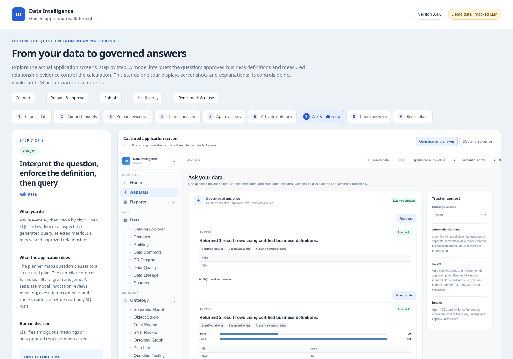

# Application 8.4.0 UI walkthrough

Open [`ui/application-ui-walkthrough-8.4.0.html`](ui/application-ui-walkthrough-8.4.0.html) in a browser. It is standalone: screenshots and walkthrough data are embedded. Use the nine step buttons, Next/Back or arrow keys. Click screenshots to enlarge. The Revenue/Now by city controls illustrate the fixed demonstration calculation; no model or warehouse request is made by this tour.

The screenshots are captured from the real application running with an isolated SQLite business fixture and explicitly mocked Bedrock responses. The screenshots do not demonstrate live AWS access or general language-model accuracy. The report widgets were created through the supported report API; the unified Ask screen currently lacks an Add to report button.

Steps: scoped catalog → verified models → guided preparation → executable definitions → measured relationships → certified release → Ask and follow-up → independent result benchmarks → pinned reports.

Human review is required to decide and certify business meanings, units, grain, additive behavior, date roles, predicates and relationship roles. Routine unchanged passing evidence refresh does not require renewed meaning approval.

The demo's approved net_sales measure sums amount minus refund for Complete orders. It returns 350 USD; grouping by customer city returns Berlin 90 and Paris 260. The cancelled order remains excluded. See [`ui/screens/ask-example.json`](ui/screens/ask-example.json) for the actual captured API responses and SQL.

The full application supports bounded aggregate queries within one connector/database and directional many-to-one joins. Fiscal calendars, cross-source/fact-to-fact calculations and unsupported local-time timestamp operations require additional implementation. Restricted semantic columns and active row policies currently block execution pending policy-aware compilation.

