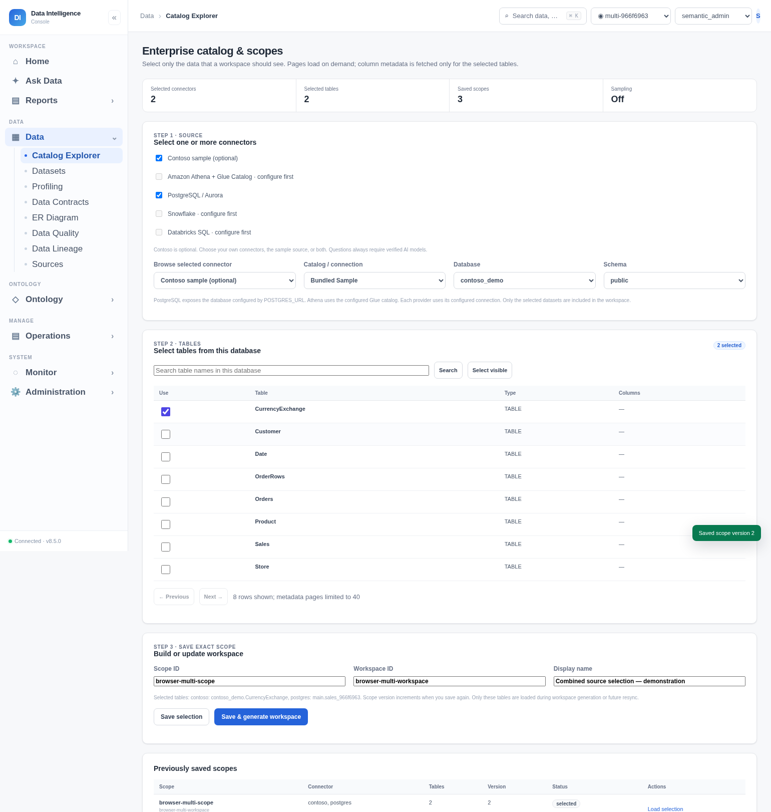
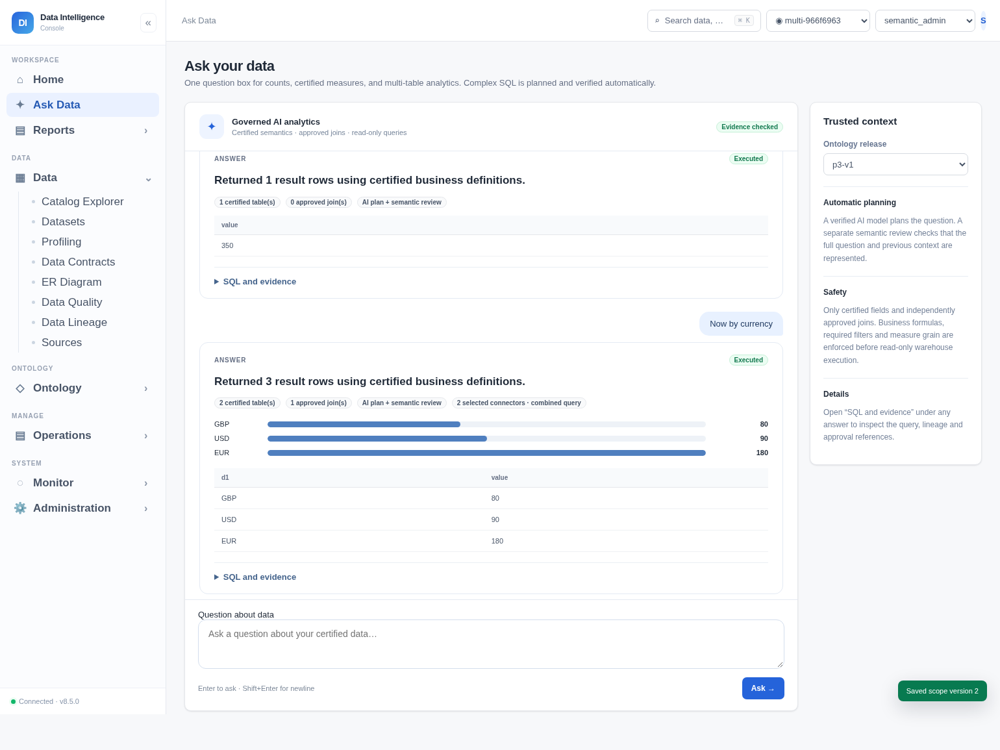

# Follow the optional-sample and multi-connector UI — 8.5.0

The screenshots below are captured from the actual 8.5.0 application. Bedrock responses are explicitly mocked; SQL executes against isolated PostgreSQL-adapter/SQLite data and the bundled Contoso database. They do not establish live enterprise connector or LLM accuracy.

1. Open **Data → Catalog Explorer**. No connector or dataset is selected automatically.
2. Check Contoso, your configured connector(s), or both. Browse one selected connector at a time and select its datasets; earlier selections remain in the same workspace selection.
3. Save/generate the workspace, review and certify its business definitions and relationships, and activate a release. A cross-connector join needs an approved relationship; similar column names alone never enable execution.
4. With verified planning/review models, ask a question. A one-source question executes natively; a question spanning connectors uses complete bounded snapshots and displays its combined-source status.

The demonstration asks Net sales (350 USD) followed by Now by currency (EUR 180, GBP 80, USD 90). The approved measure uses already normalized USD amounts; the grouping describes original billing currency, not an automatic currency conversion.

See [the source/data workflow](MULTI_CONNECTOR_WORKFLOW.md) for limits and [the current pending-work audit](PENDING_WORK_8.5.0.md) for remaining work. The older [8.4.0 walkthrough](UI_WALKTHROUGH_8.4.0.md) is retained as historical screenshots of the earlier interface.
